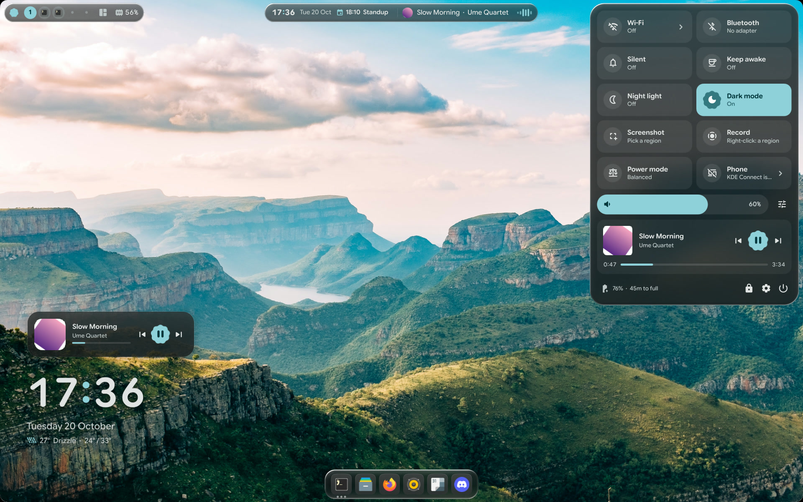
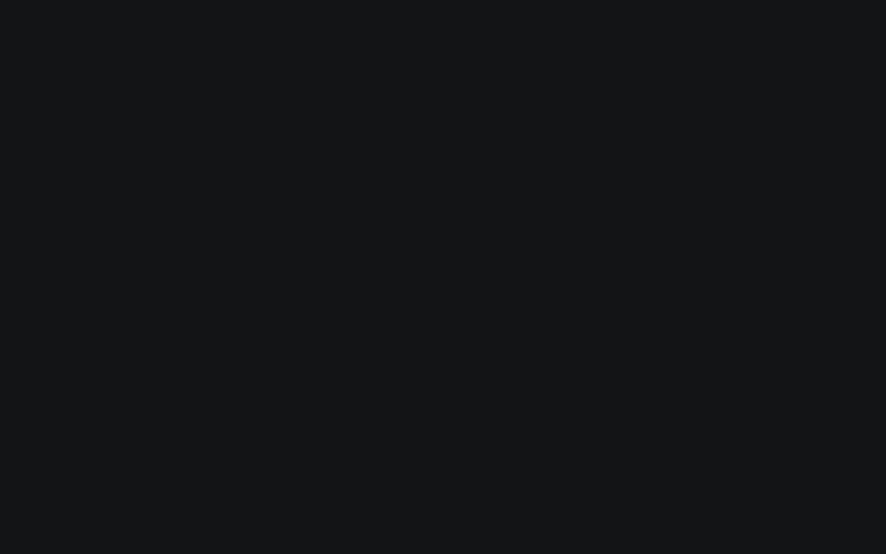
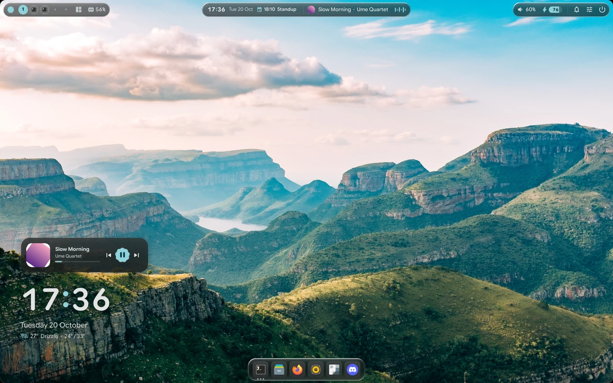
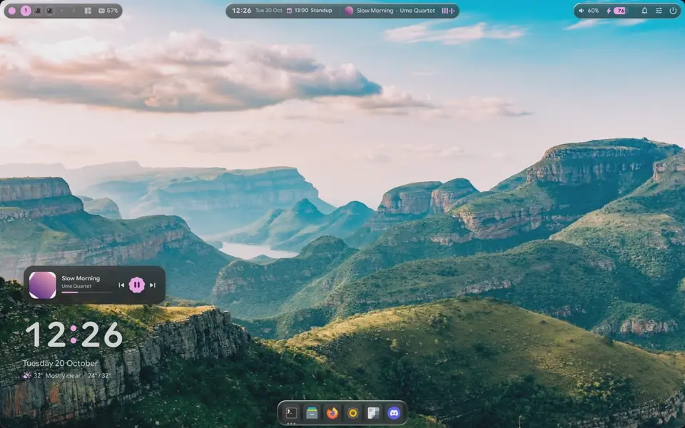
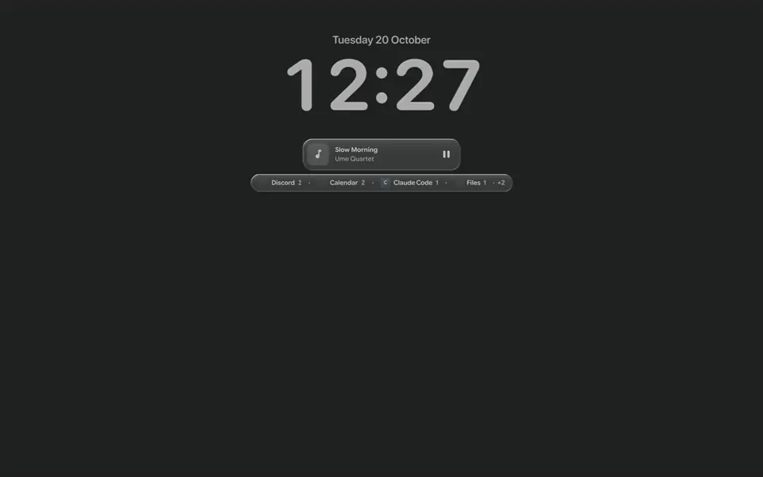

# ume 梅

A personal Wayland desktop shell written in [Quickshell](https://quickshell.org) (QML) for the
[mango](https://github.com/mangowm/mango) compositor. Liquid-glass islands, colors taken from the
wallpaper, and every piece of the desktop in one shell.

> This is my daily setup on one laptop, published as-is. It's tuned to my hardware and my
> taste, so expect to read and change some code before it fits yours. Inside the code it's
> still called **mine** (`qs -c mine`, `~/.config/quickshell/mine`).



## Tour

Every clip below is the real shell, recorded in a headless session with made-up data
(notifications, music, calendar, clipboard). That session had no network or Bluetooth, so those
show as off. The whole walkthrough as one video (2 min, 1920×1200 MP4, 37 MB):
[walkthrough.mp4](https://github.com/letrquan/ume/releases/download/walkthrough/walkthrough.mp4).

<table>
<tr>
<td width="50%"><br><b>Desktop</b>: three glass islands, the dock, a desktop clock with the weather and music. Hover a stat for more; plugging in the charger grows a live activity out of the middle island.</td>
<td width="50%"><br><b>Notifications</b> grow out of the middle island. The list, grouped by app, sits behind the bell.</td>
</tr>
<tr>
<td><br><b>Launcher</b> (tap Super): apps, settings, math and emoji (<code>:</code>) in one field.</td>
<td><br><b>Control center</b> (Super+N): toggles, volume, the player and the battery.</td>
</tr>
<tr>
<td><br><b>Now Playing</b>: click the music in the bar. The accent colors follow the album art.</td>
<td><br><b>Calendar</b> (click the clock): your <code>.ics</code> events and the next hours of weather.</td>
</tr>
<tr>
<td><br><b>Overview</b> (Super+O, the hot corner, 4 fingers): every workspace with live windows. Type to find one, drag to move it.</td>
<td><br><b>Alt+Tab</b>: hold Alt, tap Tab, let go to switch.</td>
</tr>
<tr>
<td><br><b>Wallpaper</b> (Super+Y): the new one spreads from where you clicked, and every color follows it (matugen).</td>
<td><br><b>Volume popup</b> and the <b>power menu</b> (Super+X).</td>
</tr>
<tr>
<td><br><b>Cheat sheet</b> (Super+/): every shortcut, read from mango's config.</td>
<td><br><b>Settings</b> (Super+,): every knob of the shell, searchable.</td>
</tr>
<tr>
<td><br><b>Clipboard history</b> (Super+V). API keys, tokens and one-time codes are left out, and so is whatever a password manager marks secret.</td>
<td><br><b>Lock screen</b>: face unlock (optional), a wrong password shakes, and "while you were away" lists what came in.</td>
</tr>
</table>

## What's in it

- **Bar**: three glass islands (left, clock, right) whose items you can rearrange, a live-activity
  segment in the middle island, and a system tray
- **Notifications** that grow out of the middle island, with a history list behind the bell
- **Launcher** (tap Super) with an app, emoji, calculator and settings search, and a **clipboard history** (Super+V)
- **Control center** (Super+N) for Wi-Fi, Bluetooth, audio, night light, phone (KDE Connect) and media
- **Dock**, **overview** (Super+O / hot corner) with live window pictures and drag between workspaces,
  and an **Alt+Tab** switcher
- **OSD** for volume, brightness, mic, caps lock and num lock
- **Wallpaper picker** (Super+Y) with [matugen](https://github.com/InioX/matugen) colors pushed to
  GTK, foot, starship and mango's borders
- **Screenshots** (freeze, then pick a region or window), **screen recording**, **OCR** (Super+Shift+T)
  and a **color picker**
- **Calendar** with weather (Open-Meteo) and `.ics` events, a desktop clock, and a **Now Playing** card
- **Power menu**, **polkit** password dialog, **lock screen** (`lock.qml`), and an optional
  **greetd login screen** built from the same parts
- **Idle**: dim, screen off and lock, with an optional presence sensor lock
- **Settings window** (Super+,) where every knob in `common/Style.qml` can be changed
- **Tablet mode**: on-screen keyboard, auto-rotate
- **Cheat sheet** of every shortcut (Super+/)

## Requirements

Developed on CachyOS with these versions:

| | |
|---|---|
| Shell | `quickshell` 0.3.2, Qt 6 |
| Compositor | `mango` 0.18 (talks to it through `mmsg`) |
| Colors | `matugen` 4.x |
| Fonts | Google Sans Flex, Material Symbols Rounded |
| Clipboard | `wl-clipboard`, `cliphist`, `wl-clip-persist` |
| Screenshots | `grim`, `slurp`, `swappy`, `tesseract` (OCR), `hyprpicker`, `wf-recorder`, `imagemagick` |
| System | `brightnessctl`, `wlsunset`, `hypridle`, `iio-sensor-proxy`, `iproute2`, `jq`, `curl` |
| Optional | `cava` (visualizer), `kdeconnect` (phone), `wtype` (on-screen keyboard), `hyprlock` (lock fallback), `howdy` (face unlock), `greetd` + `cage` (login screen) |

The icon theme is set to `ZorinGrey-Dark` at the top of `shell.qml`, `lock.qml` and
`lock-preview.qml`. Change it to one you have.

## Install

```sh
git clone https://github.com/letrquan/ume ~/.config/quickshell/mine
install -Dm755 ~/.config/quickshell/mine/extras/bin/mine    ~/.local/bin/mine
install -Dm755 ~/.config/quickshell/mine/extras/bin/qs-lock ~/.local/bin/qs-lock
cp ~/.config/quickshell/mine/extras/mango/shell-mine.conf ~/.config/mango/
touch ~/.config/mango/noctalia-colors.conf   # the shell fills it with wallpaper colors
```

Then add `source=./shell-mine.conf` to `~/.config/mango/config.conf`, log out and log back in.
That file starts the shell (`mine start`, which restarts it if it crashes), starts the backup lock
(`scripts/lock-guard.sh`) and binds the keys.

To try it without mango's keybinds, run `qs -c mine`.

### Settings

Your changes are saved in `~/.local/state/mine-shell/settings.json`. Any value missing there
falls back to the default in `common/Style.qml`. Weather defaults to Ho Chi Minh City; change it
in Settings → Calendar & weather.

### Things that touch the system

These scripts use `sudo` and change files under `/etc`. Read them before running them. Each one
has an undo script.

- `greeter-setup/`: greetd login screen (`greeter-install.sh` / `greeter-revert.sh`)
- `setup/face-setup.sh`: Howdy face unlock for the lock screen only (`face-undo.sh`)
- `setup/boot-setup.sh`: quiet boot (hidden GRUB menu, plymouth) (`boot-undo.sh`)
- `scripts/tablet-keyboard.sh`: libinput quirk that keeps the keyboard working in tablet mode

### Hardware notes

Written on an HP OmniBook 2-in-1 (AMD, 1.25 scale, OLED). Some parts assume it:

- the built-in screen is `eDP-1` (auto-rotate, pen mapping)
- the presence lock reads an iio proximity sensor
- tablet mode comes from mango's `fold`/`unfold` switch events
- `scripts/tablet-keyboard.sh` targets that laptop's keyboard

`extras/bin/mine` also falls back to [Noctalia](https://github.com/noctalia-dev/noctalia-shell)
when the shell isn't running. Without Noctalia, those fallbacks just do nothing.

## Layout

```
shell.qml        entry point (qs -c mine)
lock.qml         the lock screen, started by qs-lock
greeter.qml      the greetd login screen
common/          Style (every knob), Motion, Colors, glass, shapes, shaders
services/        state and system glue (audio, network, notifications, idle, mango, ...)
bar/ dock/ control/ launcher/ notifications/ overview/ ...   one folder per surface
matugen/         color templates
scripts/         helpers the shell runs
extras/          ~/.local/bin/mine, qs-lock and the mango config
```

After editing a shader, rebuild its `.qsb` with Qt's `qsb` (`/usr/lib/qt6/bin/qsb` on Arch):

```sh
qsb --glsl "100 es,120,150,300 es,330" --hlsl 50 --msl 12 \
    -o common/shaders/glassrim.frag.qsb common/shaders/glassrim.frag
```

## Credits

- `common/shapes/`: [rounded-polygon-qmljs](https://github.com/end-4/rounded-polygon-qmljs) by end-4
  (Apache-2.0, license in that folder), a port of AndroidX's shape library
- The lock screen's typed-character shapes and opening animation follow
  [Caelestia](https://github.com/caelestia-dots/shell)'s lock
- Motion curves follow [end-4's dots](https://github.com/end-4/dots-hyprland) and Material 3 Expressive
- Emoji names come from GTK 4's emoji data (Unicode CLDR)
- Wallpapers in the screenshots and clips: Unsplash photos that ship with Zorin OS (Canyon by
  Ashim D'Silva, Waves by Angus Gray and the rest of the picker), the Tarantula Nebula (NASA, ESA,
  CSA, STScI; public domain), M83 (NASA, ESA and the Hubble Heritage Team; public domain) and a beech
  forest (W.carter, CC0)

## License

GPL-3.0. See [LICENSE](LICENSE).
